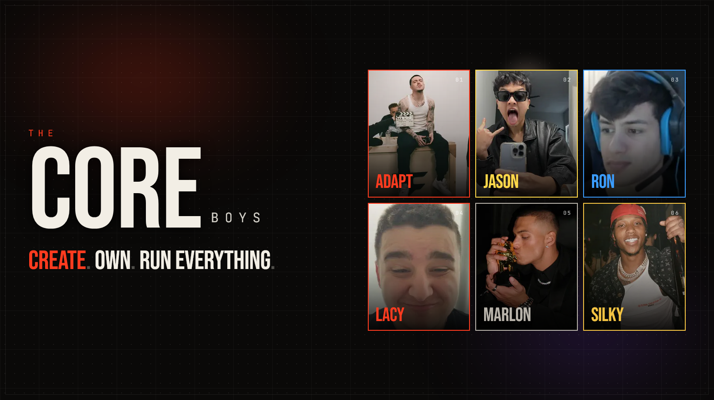

# coreboys-web

[](https://github.com/thecoreboys/coreboys-web/actions/workflows/security-checks.yml) [](https://github.com/thecoreboys/coreboys-web/actions/workflows/codeql.yml)

The public CORE site for The Core Boys: home and channel discovery, live and
archived playback, Multiview, fan accounts, community features, and staff
administration. The application uses Next.js 15, React 19, TypeScript,
Tailwind CSS, and pnpm.



> Create. Own. Run. Everything.

## Architecture

Read [the current architecture](docs/ARCHITECTURE.md) for service boundaries,
authentication, data storage, deployment, and migration ownership.

| Location | Responsibility |
| --- | --- |
| `app/` | App Router pages, layouts, and server API handlers. |
| `components/watch/`, `lib/watch/` | Catalog, playback, channels, guide, and Multiview. |
| `components/providers/` | Fan authentication, persistent player, and other client contexts. |
| `app/admin/`, `app/studio/`, `lib/admin-api.ts` | Staff interfaces and database-backed authorization. |
| `lib/fan-auth.ts`, `app/api/auth/`, `app/api/oauth/` | Custom fan sessions and provider connections. |
| `scripts/migrations/` | Web-owned SQL registered by `scripts/apply-web-migrations.mjs`. |
| `workers/` | Separately operated face analyzer and chat listener. |
| `native/expo/` | Expo WebView client with independent dependencies and checks. |

## Development and checks

Use Node.js 20 or later and pnpm 10. Run these commands from this repository:

```sh
pnpm install --frozen-lockfile
pnpm typecheck
pnpm lint
pnpm test
pnpm dev
```

The development pre-hook runs `scripts/sync-db-firewall.mjs`; configure the
local environment before starting against a shared database. Create a local
`.env.local` with the settings needed for the features being developed. The
[architecture and integration references](docs/ARCHITECTURE.md#integration-and-operation-references)
identify the feature-specific setup documents.

`pnpm typecheck` runs `next typegen` before `tsc --noEmit`. This generates route
and page definitions in a fresh checkout and refreshes them when routes are
added. `pnpm lint` uses the ESLint CLI and the rules in `eslint.config.mjs`.
Generated `next-env.d.ts`, TypeScript caches, `.next*`, `.tmp/`, and `output/`
files are ignored.

`pnpm build` creates the production Next.js build. Windows contributors who
cannot create standalone symlinks can set `CORE_NEXT_STANDALONE=0` for a local
build. Custom builds can isolate output with `CORE_NEXT_DIST_DIR` and a matching
`CORE_NEXT_TSCONFIG`; keep temporary build paths out of the shared config.

## CI and production

[CI](.github/workflows/ci.yml) installs locked dependencies and runs web
typecheck, lint, tests, and isolated SQL verification. Separate jobs check the
face worker and the Expo client.

[Production deployment](.github/workflows/deploy-azure.yml) runs on pushes to
`main` or manual dispatch. It builds the standalone Docker image, pushes a
commit SHA tag to Azure Container Registry, applies registered web and media
intelligence migrations, configures runtime secrets, deploys Azure Container
Apps, checks the application URL, and configures scheduled ingestion jobs.
`NEXT_PUBLIC_*` values are image build inputs; server credentials are runtime
secrets. The workflow defines the exact inputs and feature flags.

## Shared data

The web dependency is `@coreboys/shared` from `file:vendor/coreboys-shared`.
The vendored built package is committed so private-repository cloud builds
need no extra GitHub token. Canonical member and crew data is maintained in the
separate `coreboys-shared` repository; update its source and the vendored build
together when changing those records.

Web-only biographies, portrait paths, stage names, and display order are
wrapped in `lib/members.ts`. Keep canonical social and identity data in the
shared package. Use `DISPLAY_ORDER` in the web wrapper to change its ordering.

## Feature references

- [Watch reliability](docs/WATCH_RELIABILITY.md) and [performance](docs/performance.md).
- [Social connections](docs/SOCIAL_MEDIA_CONNECTIONS.md) and [X feeds](docs/x-live-feed.md).
- [Mobile external navigation](docs/mobile-external-navigation.md).
- [Billing setup](docs/STRIPE_MEMBERSHIP_SETUP.md) and [email](docs/RESEND_EMAIL.md).
- [Contributor applications](docs/community-applications.md).
- [Design conventions](docs/DESIGN.md) and [theming](THEMING.md).

## Attribution

Built and maintained by [MDCran](https://github.com/MDCran).
