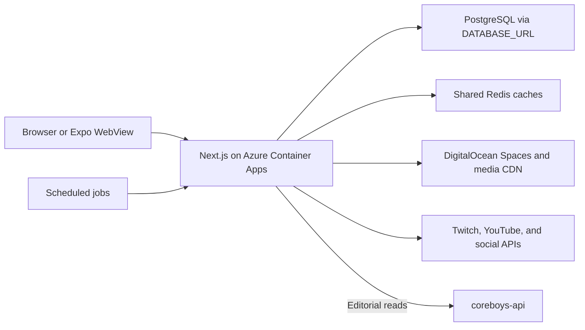

# CORE web architecture

Reviewed against the application and deployment workflows on 2026-11-11.
This document describes the implemented system. Feature plans live in their
individual design documents.

## Runtime and service boundaries

The public site is a Next.js 15 App Router application using React 19,
TypeScript, Tailwind CSS, and pnpm. Its server components and route handlers
own fan accounts, staff administration, the watch catalog, community features,
and provider integrations. Many of these paths query PostgreSQL directly.



| Component | Responsibility and source |
| --- | --- |
| `coreboys-web` | Public pages, `/admin`, `/studio`, and same-origin `/api` handlers in this repository. |
| `@coreboys/shared` | Canonical member, crew, and domain data. The web dependency is `file:vendor/coreboys-shared`; its built package is committed so image builds need no private repository token. |
| `coreboys-api` | Separate Hono service with versioned public/editorial/admin endpoints. Its repository contains Railway deployment configuration. Web editorial reads use [`lib/blog.ts`](../lib/blog.ts). |
| `coreboys-db` | Shared database schema, migrations, and queries for consumers of `@coreboys/db`. The web app also owns the SQL extensions described below. |
| `coreboys-cms` | Separate Next.js authoring app with its own custom session authentication. The public site's administration is also implemented in `coreboys-web`. |
| `native/expo` | Expo WebView client with a separate package, lockfile, TypeScript config, and CI job. See [mobile external navigation](mobile-external-navigation.md). |

Sibling release directories in the development workspace are Git worktrees or
independent repositories. Each has its own checked-out commit and working
changes; advancing one checkout does not advance the others. The standalone
`coreboys-fan-app` repository also has its own EAS build configuration.

## Application surfaces

| Surface | Main implementation |
| --- | --- |
| Home, guide, channels, and catalog | `app/page.tsx`, `app/guide`, `app/channels`, `components/watch`, and `lib/watch`. |
| Persistent playback and Multiview | `components/providers/PlayerProvider.tsx`, `components/watch/PersistentPlayer.tsx`, and `components/watch/MultiPlayerStage.tsx`. |
| Fan accounts and saved state | `app/api/auth`, `app/api/account`, and `lib/fan-auth.ts`. |
| Staff and content management | `app/admin`, `app/studio`, `app/api/admin`, and `lib/admin-api.ts`. |
| Social data and notifications | Provider-specific handlers under `app/api`, scheduled workflows, and the integration documents linked below. |

Client components use same-origin route handlers for protected writes and
provider credentials. Public catalog snapshots use the caching helpers in
[`lib/server-cache.ts`](../lib/server-cache.ts) and
[`lib/public-cache.ts`](../lib/public-cache.ts). The Redis and process-local
cache behavior is implemented by those helpers; credentials and database
connection details stay on the server.

## Authentication and authorization

The web app uses `jose` session tokens and password authentication backed by
PostgreSQL. Session signing, OAuth connection encryption, and the preview
access gate use separate secrets.

| Identity | Cookie and controls |
| --- | --- |
| Fan | `coreboys-fan-session`, HS256, 30-day lifetime, `HttpOnly`, `SameSite=Lax`, and `Secure` in production. Signing requires `FAN_SESSION_SECRET`. See [`lib/fan-auth.ts`](../lib/fan-auth.ts). |
| Staff | `coreboys-admin-session`, HS256, 12-hour lifetime, signed with `ADMIN_SESSION_SECRET`. Protected handlers resolve the current database role, member assignment, deactivation, and session version; elevated administrators also require TOTP. See [`lib/admin-auth.ts`](../lib/admin-auth.ts) and [`lib/admin-api.ts`](../lib/admin-api.ts). |
| Preview visitor | `coreboys-site-access`, a signed seven-day access token. The production gate is enabled when both `SITE_ACCESS_CODE` and `SITE_ACCESS_COOKIE_SECRET` are configured. See [`middleware.ts`](../middleware.ts) and [`lib/site-access.ts`](../lib/site-access.ts). |

Provider account connections are handled under `app/api/oauth` and use
`FAN_OAUTH_KEY` for stored connection secrets. A preview access token admits
a visitor to the site; fan and staff permissions are checked by their own
handlers. Webhooks and scheduled routes authenticate independently using
their configured signatures or job secrets.

## Database and media

[`lib/db.ts`](../lib/db.ts) owns the web PostgreSQL connection pool through
`DATABASE_URL`. It currently caps each process at three pooled connections.
Database hosting is configured outside the web image; the deployment workflow
uses the supplied connection URL rather than provisioning a database.

There are separate migration owners:

- `coreboys-db/migrations` contains the shared database package migrations.
- `scripts/migrations` contains web-owned SQL registered in
  [`scripts/apply-web-migrations.mjs`](../scripts/apply-web-migrations.mjs).
- The media intelligence migration runner is
  `scripts/apply-media-intelligence-migrations.mjs`.

The Azure deployment runs the registered web and media intelligence migrations
before updating the application revision. Some features have runtime schema
guards, but the registered runners remain part of the release process.

Multiview remote state lives in `fan_multiview_sessions`. Its route handlers
scope discovery and commands to the signed-in fan account; host writes also
require the host secret. Heartbeats renew a 75-second lease. Contributor
applications store encrypted details and a hashed IP fingerprint, with an
administrator-only inbox. Their schemas are registered as migrations 066
and 065 respectively.

Static artwork, fonts, and selected media ship from `public/`. Upload helpers
such as [`lib/spaces.ts`](../lib/spaces.ts) use DigitalOcean Spaces through
the S3-compatible AWS SDK. `SPACES_*` variables identify the storage endpoint,
bucket, credentials, and CDN endpoint. `next.config.ts` defines allowed image
origins, media caching headers, and the external house-reel redirect.

## Deployment and scheduled work

[`deploy-azure.yml`](../.github/workflows/deploy-azure.yml) defines production
web delivery. It runs on pushes to `main` and manual dispatch:

1. Install the locked dependencies and run typecheck, lint, and tests.
2. Check the configured billing mode and build the standalone Next.js image
   from [`Dockerfile`](../Dockerfile).
3. Push an image tagged with the commit SHA to Azure Container Registry.
4. Apply the registered database migrations.
5. Configure runtime secrets and deploy the image to the `coreboys-web`
   Azure Container App in the configured resource group.
6. Check the application URL and configure scheduled social ingestion jobs.

Azure authentication uses GitHub OIDC. Server secrets are configured at
runtime; `NEXT_PUBLIC_*` settings used by the browser are build arguments and
require an image rebuild when changed. The workflow is the authoritative list
of deployment inputs and feature flags.

The container's health check and the rollout check request `/`. A successful
response confirms HTTP availability; provider integrations and authenticated
flows require their own checks. Provider quotas, enabled billing operations,
and consent requirements are described in the feature documents.

Scheduled work is defined in the deployment workflow and `cron-*.yml`
workflows. The face analyzer and chat listener under `workers/` have separate
runtime and deployment requirements. See the relevant worker files before
enabling them.

## Local development and checks

Run commands from `repos/coreboys-web`; the workspace parent has no root pnpm
package. Use Node.js 20 or later and pnpm 10.

```sh
pnpm install --frozen-lockfile
pnpm typecheck
pnpm lint
pnpm test
pnpm dev
```

`pnpm typecheck` runs `next typegen` before `tsc --noEmit`, so route types are
generated from the current source in a fresh checkout. This follows the
[Next.js type generation workflow](https://nextjs.org/docs/app/api-reference/cli/next#next-typegen-options).
`pnpm lint` runs ESLint directly with `eslint.config.mjs`. CI and deployment
both run these checks.

The development pre-hook runs `scripts/sync-db-firewall.mjs`; inspect its
configuration before starting against a shared database. Custom builds can use
`CORE_NEXT_DIST_DIR` and `CORE_NEXT_TSCONFIG` to isolate output and TypeScript
configuration. Keep private build-directory names out of the shared config.

`next-env.d.ts`, incremental TypeScript caches, `.next*`, `.tmp/`, and
`output/` are generated local files. Keep source code, tests, and registered
migrations in Git. Local secret files stay ignored.

## Integration and operation references

- [Social connection setup](SOCIAL_MEDIA_CONNECTIONS.md)
- [Twitch and YouTube watch reliability](WATCH_RELIABILITY.md)
- [X integration](X_INTEGRATION.md) and [live feed delivery](x-live-feed.md)
- [TikTok integration](TIKTOK_INTEGRATION.md)
- [Email delivery](RESEND_EMAIL.md)
- [Billing configuration](STRIPE_MEMBERSHIP_SETUP.md)
- [Media intelligence](LOCAL_MEDIA_INTELLIGENCE.md)
- [Face presence](FACE_PRESENCE_MVP.md) and [enrollment operations](face-enrollment-operations.md)
- [Contributor applications](community-applications.md)
- [Design conventions](DESIGN.md)
